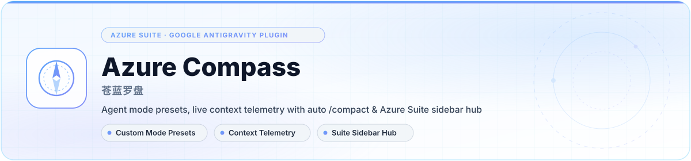
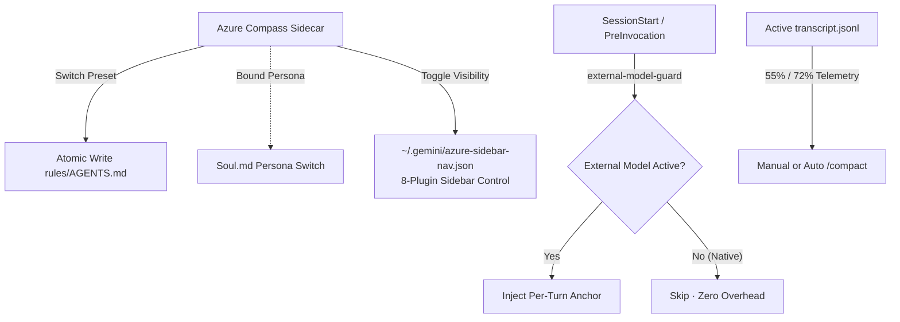

<div align="center">

<p>🌐 &nbsp; <a href="README.md">简体中文</a> &nbsp;·&nbsp; <strong>English</strong></p>

<picture>
  <source media="(prefers-color-scheme: dark)" srcset="assets/readme/hero-en-dark.svg">
  
</picture>

<p>
  [](https://github.com/A16Nights/antigravity-azure-compass/releases)
  [](https://github.com/A16Nights/antigravity-azure-compass/stargazers)
  
  
  
  [](./LICENSE)
</p>

<p>
  <strong>One-click Agent mode presets, live context telemetry with automatic /compact, and centralized Azure Suite sidebar control</strong>
</p>

<p>
  <a href="#features">✨ Features</a> &nbsp;·&nbsp; <a href="#architecture">🧩 Architecture</a> &nbsp;·&nbsp; <a href="#installation">🚀 Quick Start</a> &nbsp;·&nbsp; <a href="#storage">📂 Storage</a> &nbsp;·&nbsp; <a href="#azure-suite">🌌 Azure Suite</a>
</p>

</div>

Agent mode preset center, real-time context watermark monitor, and global Azure Suite sidebar hub for **Google Antigravity**. Combines **static rules (`rules/AGENTS.md`) + lifecycle hooks (`SessionStart` & `PreInvocation`) + Sidecar/Web UI** to eliminate instruction drift and integrate deeply with **[Soul.md](https://github.com/A16Nights/antigravity-soul-md)**, **[Lanxi Memory](https://github.com/A16Nights/antigravity-lanxi-memory)**, and native `/compact`.

<table>
<tr>
<td width="50%" valign="top">
<h4>🧭 4 Built-in + Custom Presets</h4>
Includes <code>standard</code>, <code>orchestrator</code>, <code>minimal</code>, and <code>review</code> plus unlimited custom presets with optional <code>soul-md</code> persona binding.
</td>
<td width="50%" valign="top">
<h4>🛡️ Smart External-Model Guard</h4>
Built-in <code>external-model-guard</code> injects per-turn anchors only when an external custom model is active—zero extra token overhead on native models.
</td>
</tr>
<tr>
<td width="50%" valign="top">
<h4>📈 Context Telemetry & Auto /compact</h4>
Reads active <code>transcript.jsonl</code> to estimate context fill, provides 55%/72% alerts, and triggers native <code>/compact</code> manually or automatically at the redline.
</td>
<td width="50%" valign="top">
<h4>🎛️ Azure Suite Sidebar Hub</h4>
Lists all installed Azure Suite plugins in one place and lets you toggle each plugin's global Antigravity left-sidebar shortcut independently.
</td>
</tr>
</table>

<h2 id="features">
<picture>
  <source media="(prefers-color-scheme: dark)" srcset="assets/readme/sec-features-en-dark.svg">
  
</picture>
</h2>

### 1. Four Core Built-in Agent Mode Presets
- **`standard`**: Balanced engineering mode for daily coding, file editing, commands, and documentation.
- **`orchestrator`**: Instructs the primary agent to focus on planning and verification while delegating multi-file searches, >15-line edits, log diagnostics, and text generation to **[External Orchestrator](https://github.com/A16Nights/antigravity-external-orchestrator)**.
- **`minimal`**: Minimizes tool round-trips and prose, going straight to conclusions and essential code.
- **`review`**: Strict read-only code review, architecture audit, and bug hunting—prohibits modifying business files.

### 2. Custom Preset Management (Create / Edit / Delete)
- Click **`＋ New Preset`** in the Custom section to craft your own workflow mode:
  - Configure **Preset ID**, **Display Name**, and **Summary**;
  - Author full **Static Rules** (atomically written to `rules/AGENTS.md` on switch) and a **Per-Turn PreInvocation Anchor**;
  - **Soul.md Persona Binding**: Bind a `soul-md` persona card so switching modes automatically switches the active global persona;
  - Edit anytime or delete safely via an in-panel glass confirmation modal (deleting the active preset smoothly reverts to `standard`).

### 3. Smart External-Model Detection & Anti-Drift Hooks
- **`SessionStart` Anchoring**: Injects active mode boundaries at the start of every new conversation.
- **`PreInvocation` Guard (`external-model-guard`)**: Injects per-turn anchor reinforcement only for external custom models, skipping native Antigravity models automatically to save tokens. Toggleable from the top bar.

### 4. Context Watermark Telemetry & Automatic `/compact`
- **Live Estimation**: Inspects the active conversation's `transcript.jsonl` to compute estimated context usage %, step count, and the latest `CHECKPOINT`.
- **Two-Tier Thresholds**: Stage notice (default 55%) and high-priority redline warning (default 72%), with selectable window targets (`128k` / `200k` / `256k` / `500k` / `1M`).
- **Native `/compact` & Memory Archival**: One-click **Distill & Trigger `/compact`** via the local Language Server API, or enable **Auto-Compact at Redline** for hands-free long sessions.

### 5. Azure Suite Left-Sidebar Shortcut Hub
- Displays all 8 installed Azure Suite plugins at the bottom of the panel with individual switches to show or hide each plugin's left-sidebar shortcut.

### 6. Unified Azure Suite UI
- **Neko Glass UI & Shared Theme Center**: Dark/light mode, custom glass dropdowns (`AzureSelect`), 6 official theme presets + dual custom pickers + 4 shared custom slots, standalone `Web UI`, and GitHub Release update checks.

<h2 id="architecture">
<picture>
  <source media="(prefers-color-scheme: dark)" srcset="assets/readme/sec-arch-en-dark.svg">
  
</picture>
</h2>



<h2 id="installation">
<picture>
  <source media="(prefers-color-scheme: dark)" srcset="assets/readme/sec-install-en-dark.svg">
  
</picture>
</h2>

> **Prerequisite**: **Node.js >= 22.0.0** (zero third-party npm dependencies, pure native ESM).

### Option 1 · Let Antigravity Install It for You (Recommended)

Copy and send the following prompt directly to Antigravity:

> Please clone `https://github.com/A16Nights/antigravity-azure-compass.git` into my Antigravity global plugins directory as `agent-presets`, verify the directory structure, and tell me once it is ready so I can press `Ctrl+R` to reload.

### Option 2 · Manual Git Clone

```powershell
# Windows (PowerShell)
git clone https://github.com/A16Nights/antigravity-azure-compass.git "$env:USERPROFILE\.gemini\config\plugins\agent-presets"

# macOS / Linux
git clone https://github.com/A16Nights/antigravity-azure-compass.git ~/.gemini/config/plugins/agent-presets
```

Restart or reload Antigravity (`Ctrl+R`), enable **Azure Compass** in **Plugins**, and open it from the left sidebar or right-hand panel.

<h2 id="storage">
<picture>
  <source media="(prefers-color-scheme: dark)" srcset="assets/readme/sec-storage-en-dark.svg">
  
</picture>
</h2>

<details open>
<summary><strong>Click to inspect local data paths & shared Azure Suite configs</strong></summary>

<br>

- **Presets & Context Telemetry Config**: `~/.gemini/agent-presets/config.json`
- **Azure Suite Sidebar Visibility**: `~/.gemini/azure-sidebar-nav.json`
- **Shared Azure Suite Theme**: `~/.gemini/azure-theme.json`

> All user data is isolated from the plugin directory so upgrades never overwrite your custom presets.

</details>

<h2 id="azure-suite">
<picture>
  <source media="(prefers-color-scheme: dark)" srcset="assets/readme/sec-suite-en-dark.svg">
  
</picture>
</h2>

All **8 Azure Suite plugins** share a unified **Neko Glass UI**, synchronized **Azure Theme Center** (`~/.gemini/azure-theme.json`), and customizable **Sidebar Navigation Hub** (`~/.gemini/azure-sidebar-nav.json`):

| Plugin | Repository | Core Capability |
| --- | --- | --- |
| ✦ **External Orchestrator** | [antigravity-external-orchestrator](https://github.com/A16Nights/antigravity-external-orchestrator) | Multi-provider external worker routing, custom profiles, circuit breaker & live monitoring |
| 🪐 **Azure Orbit** | [antigravity-azure-orbit](https://github.com/A16Nights/antigravity-azure-orbit) | Mount external LLM APIs directly into Antigravity's native bottom-left model selector |
| 🧭 **Azure Compass** &nbsp;`✦ This Repo` | [antigravity-azure-compass](https://github.com/A16Nights/antigravity-azure-compass) | Agent mode presets, live context telemetry with auto /compact & Azure Suite sidebar hub |
| 🏛️ **Azure Corridor** | [antigravity-azure-corridor](https://github.com/A16Nights/antigravity-azure-corridor) | Read-only FTS5 conversation search, custom project groups, priority tags & safe archive |
| 🌌 **Lanxi Memory** | [antigravity-lanxi-memory](https://github.com/A16Nights/antigravity-lanxi-memory) | 5-layer Markdown cognitive graph, CJK FTS5, tidal forgetting curves & starfield UI |
| 💎 **Soul.md Studio** | [antigravity-soul-md](https://github.com/A16Nights/antigravity-soul-md) | Hot-swappable persona cards, workspace binding, external-model anchor & layered memory |
| 💭 **Think-ZH** | [antigravity-think-zh](https://github.com/A16Nights/antigravity-think-zh) | Simplified Chinese / English reasoning switcher with dual-channel anti-drift hooks |
| 🔮 **Azure Prism** | [antigravity-azure-prism](https://github.com/A16Nights/antigravity-azure-prism) | Native MCP App Chain-of-Thought viewer with keyless zero-token MT & LLM translation |

---

<div align="center">

📄 Released under the **[MIT License](./LICENSE)** · Crafted for **Google Antigravity**

</div>
