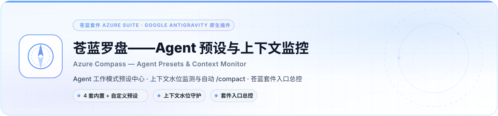
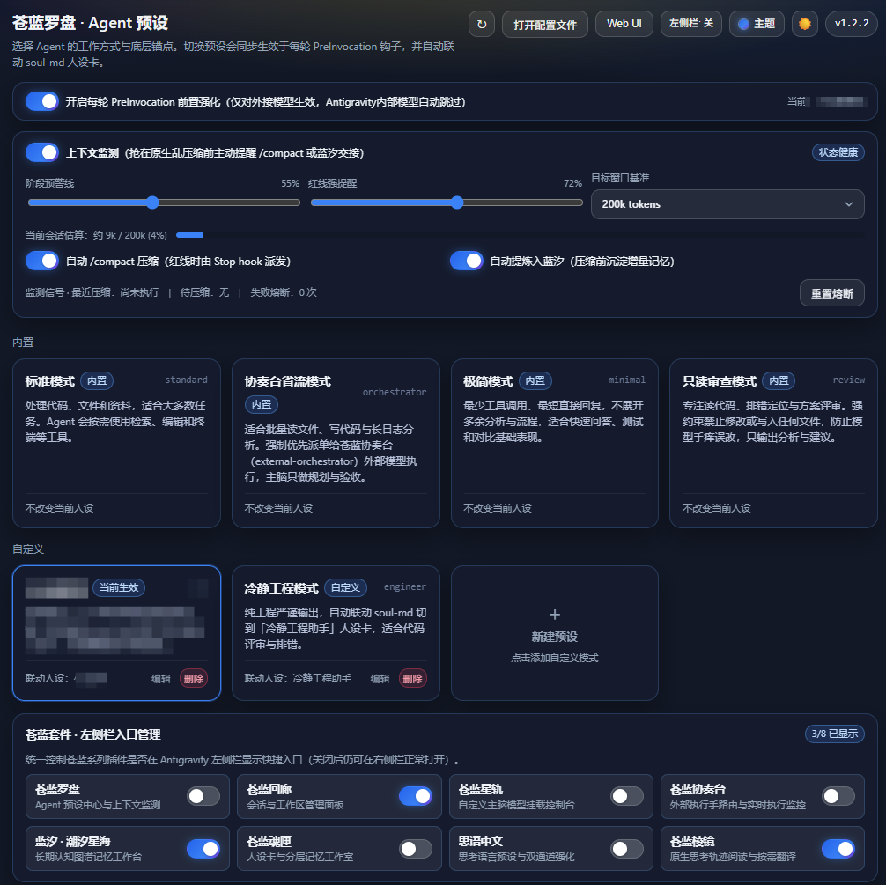
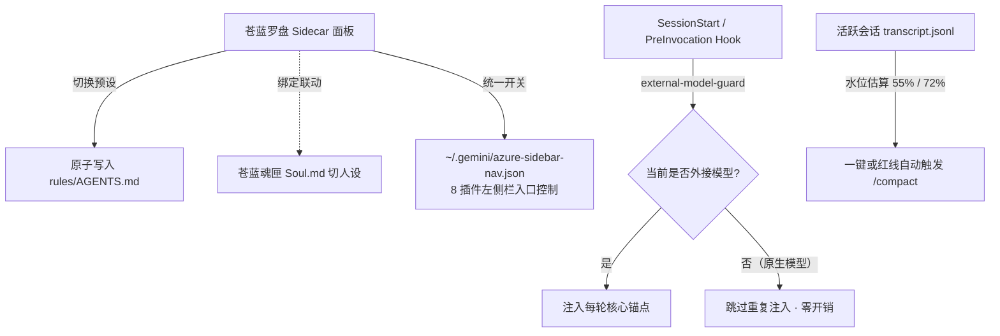

<div align="center">

<p>🌐 &nbsp; <strong>简体中文</strong> &nbsp;·&nbsp; <a href="README.en.md">English</a></p>

<picture>
  <source media="(prefers-color-scheme: dark)" srcset="assets/readme/hero-dark.svg">
  
</picture>

<p>
  <a href="https://github.com/A16Nights/antigravity-azure-compass/releases"></a>
  <a href="https://github.com/A16Nights/antigravity-azure-compass/stargazers"></a>
  
  
  
  <a href="./LICENSE"></a>
</p>

<p>
  <strong>一键切换 Agent 工作模式预设 · 上下文水位实时监测与自动 /compact · 苍蓝套件左侧栏全局入口总控</strong>
</p>

<p>
  <a href="#preview">🖼️ 界面预览</a> &nbsp;·&nbsp; <a href="#features">✨ 功能全景</a> &nbsp;·&nbsp; <a href="#architecture">🧩 工作原理</a> &nbsp;·&nbsp; <a href="#installation">🚀 快速安装</a> &nbsp;·&nbsp; <a href="#storage">📂 数据存储</a> &nbsp;·&nbsp; <a href="#azure-suite">🌌 苍蓝全家桶</a>
</p>

</div>

面向 **Google Antigravity** 的 Agent 工作模式预设中心、上下文水位实时监测与苍蓝套件全局入口管理插件。通过 **静态规则（`rules/AGENTS.md`）+ 生命周期 Hook（`SessionStart` + `PreInvocation`）+ 可视化侧栏面板**，精准解决长会话或外接模型指令漂移、掉人设问题，并与 **[苍蓝魂匣（Soul.md）](https://github.com/A16Nights/antigravity-soul-md)**、**[蓝汐（Lanxi Memory）](https://github.com/A16Nights/antigravity-lanxi-memory)** 及原生 `/compact` 深度联动。

<table>
<tr>
<td width="50%" valign="top">
<h4>🧭 4 套内置 + 无限自定义预设</h4>
内置 <code>standard</code> / <code>orchestrator</code> / <code>minimal</code> / <code>review</code>，支持自由新建、编辑与安全删除自定义模式，并联动 <code>soul-md</code> 自动切人设。
</td>
<td width="50%" valign="top">
<h4>🛡️ 外接模型智能双通道防掉线</h4>
内置 <code>external-model-guard</code>：仅在当前主模型为外接自定义模型时每轮注入前置锚点，原生模型自动跳过、零额外 Token 损耗。
</td>
</tr>
<tr>
<td width="50%" valign="top">
<h4>📈 上下文水位监测与自动 /compact</h4>
实时读取活跃会话 <code>transcript.jsonl</code> 估算 Token 占比，提供 55%/72% 两级预警与一键/红线自动触发原生 <code>/compact</code> 压缩。
</td>
<td width="50%" valign="top">
<h4>🎛️ 苍蓝套件左侧栏入口总控</h4>
集中管理本机已安装的 8 款苍蓝系列插件，一键单独开关任意插件在 Antigravity 左侧栏的全局快捷入口。
</td>
</tr>
</table>

<h2 id="preview">
<picture>
  <source media="(prefers-color-scheme: dark)" srcset="assets/readme/sec-preview-dark.svg">
  
</picture>
</h2>

<p align="center">
  <a href="assets/readme/preview-panel.png"></a>
  <br><strong>苍蓝罗盘 · Agent 预设中心、上下文水位监测与苍蓝套件左侧栏总控</strong>
  <br><sub>外接模型智能前置强化开关、55%/72% 双阈值自动 /compact、4 套内置 + 自定义预设卡片与 8 插件左侧栏统一开关</sub>
</p>

<h2 id="features">
<picture>
  <source media="(prefers-color-scheme: dark)" srcset="assets/readme/sec-features-dark.svg">
  
</picture>
</h2>

### 1. 内置 4 套核心工作模式预设
- **`standard`（标准模式）**：均衡的日常软件工程、文件读写、命令执行与资料整理模式。
- **`orchestrator`（协奏台省流模式）**：强约束主脑专注轻量规划与最终抽查验收，将多文件检索、>15 行代码编写、长日志排查与文本生成优先委派给 **[苍蓝协奏台](https://github.com/A16Nights/antigravity-external-orchestrator)** 中的高性价比外部模型执行。
- **`minimal`（极简模式）**：最小化工具调用轮次与解释篇幅，直奔结论与核心代码。
- **`review`（只读审查模式）**：专注代码走查、架构评估、安全审计与 Bug 定位，硬性约束禁止修改或覆写业务文件。

### 2. 自定义预设管理（新建 / 编辑 / 删除）
- 在「自定义」区域末尾点击 **`＋ 新建预设`** 虚线卡片即可创建专属工作模式：
  - 自定义 **预设 ID**、**显示名称**、**一句话简介**；
  - 编写 **完整静态规则正文**（切换模式时自动原子写入 `rules/AGENTS.md`）与 **每轮前置核心锚点（Anchor）**；
  - **联动 Soul.md 人设卡**：可为每个预设绑定一张 `soul-md` 人设卡，切换工作模式时自动同步切换全局生效人设卡；
  - 支持随时编辑已有自定义预设，或通过面板内毛玻璃确认弹窗安全删除（若删除当前生效预设，自动平滑切回 `standard`）。

### 3. 外接模型智能识别与双通道防掉线
- **`SessionStart` 开场锚定**：新会话启动时注入当前生效模式的核心行为边界。
- **`PreInvocation` 每轮前置强化（外接模型智能守卫）**：
  - 内置 `external-model-guard` 检测器，**仅在当前主模型为外接自定义模型时注入每轮强化锚点**；
  - 使用 Antigravity 内置原生模型时自动跳过每轮注入，零额外 Token 损耗；
  - 支持在面板顶栏一键开关每轮强化。

### 4. 上下文监测与自动 `/compact` 压缩联动
- **实时水位估算**：读取当前活跃会话的 `transcript.jsonl`，实时计算上下文 Token 占用百分比、累计步数与最近压缩断点（`CHECKPOINT`）。
- **两级阈值预警**：
  - **阶段提醒线（默认 55%）**：提示可在阶段性任务完成后主动整理上下文；
  - **红线强提醒（默认 72%）**：抢在宿主黑盒硬截断前发出高优先级预警；
  - 支持自由切换目标上下文窗口基准（`128k` / `200k` / `256k` / `500k` / `1M`）。
- **原生 `/compact` 压缩与蓝汐归档联动**：
  - 支持在面板一键触发 **「立即提炼并触发 `/compact`」**（通过本地 Language Server 接口触发原生上下文压缩，并联动蓝汐沉淀关键记忆）；
  - 支持开启 **「达到红线自动触发压缩」**，无需手动干预即可保持长会话清爽。

### 5. 苍蓝套件 · 左侧栏快捷入口统一管理
- 在面板底部集中展示本机已安装的苍蓝系列 8 款插件（苍蓝罗盘、苍蓝回廊、苍蓝星轨、苍蓝协奏台、蓝汐认知图谱、苍蓝魂匣、思语中文、苍蓝棱镜）；
- 支持一键单独开启或关闭任意插件在 Antigravity 左侧栏的全局快捷入口（关闭左侧栏入口后，仍可在右侧辅助栏或通过对话正常打开）。

### 6. 苍蓝统一视觉与交互体系
- **Neko Glass 毛玻璃界面**：支持深色 / 浅色明暗双主题切换、自定义毛玻璃下拉框（`AzureSelect`）与 7px 细圆角滚动条。
- **跨插件共享「苍蓝主题色调中心」**：内置 6 套官方主题预设、自定义主副双色取色器及 4 个自定义保存栏位，一处切换全套件实时同步。
- **独立 Web UI & 在线更新检查**：点击顶栏 `Web UI` 即可在系统默认浏览器全屏打开；点击顶栏版本号徽章可实时对比 GitHub Release 最新版本。

<h2 id="architecture">
<picture>
  <source media="(prefers-color-scheme: dark)" srcset="assets/readme/sec-arch-dark.svg">
  
</picture>
</h2>



<h2 id="installation">
<picture>
  <source media="(prefers-color-scheme: dark)" srcset="assets/readme/sec-install-dark.svg">
  
</picture>
</h2>

> **前置要求**：**Node.js >= 22.0.0**（零第三方 npm 运行时依赖，纯 Node.js 原生 ESM 实现）。

### 方式一 · 一句话让 Antigravity 帮你自动安装（推荐）

直接把下面这句话发给 Antigravity 即可自动完成克隆与核验：

> 帮我把 `https://github.com/A16Nights/antigravity-azure-compass.git` 克隆到本机 Antigravity 全局插件目录，目录名设为 `agent-presets`，检查目录无误后告诉我，我再按 `Ctrl+R` 重载生效。

### 方式二 · 命令行手动克隆

```powershell
# Windows (PowerShell)
git clone https://github.com/A16Nights/antigravity-azure-compass.git "$env:USERPROFILE\.gemini\config\plugins\agent-presets"

# macOS / Linux
git clone https://github.com/A16Nights/antigravity-azure-compass.git ~/.gemini/config/plugins/agent-presets
```

重启或重载 Antigravity（`Ctrl+R`），在 **Plugins** 面板确认 **苍蓝罗盘** 已启用，即可从左侧栏或右侧辅助面板打开。

<h2 id="storage">
<picture>
  <source media="(prefers-color-scheme: dark)" srcset="assets/readme/sec-storage-dark.svg">
  
</picture>
</h2>

<details open>
<summary><strong>点击展开查看本机数据目录与苍蓝套件共享配置路径</strong></summary>

<br>

- **预设与上下文监测配置**：`~/.gemini/agent-presets/config.json`
- **苍蓝套件左侧栏显示配置**：`~/.gemini/azure-sidebar-nav.json`
- **苍蓝套件共享主题配置**：`~/.gemini/azure-theme.json`

> 所有用户配置与插件代码目录完全隔离，升级插件不会丢失自定义预设。

</details>

<h2 id="azure-suite">
<picture>
  <source media="(prefers-color-scheme: dark)" srcset="assets/readme/sec-suite-dark.svg">
  
</picture>
</h2>

**苍蓝套件（Azure Suite）** 8 款插件共享统一的 **Neko Glass 毛玻璃界面**、跨插件同步的 **苍蓝主题色调中心**（`~/.gemini/azure-theme.json`）以及可自由开关的 **左侧栏快捷入口**（`~/.gemini/azure-sidebar-nav.json`）：

| 插件 | 仓库 | 核心能力 |
| --- | --- | --- |
| ✦ **苍蓝协奏台** | [antigravity-external-orchestrator](https://github.com/A16Nights/antigravity-external-orchestrator) | 多渠道外部模型协同调度、自定义调度角色、容灾断路器与全链路实时监控 |
| 🪐 **苍蓝星轨** | [antigravity-azure-orbit](https://github.com/A16Nights/antigravity-azure-orbit) | 将外部大模型直接挂载进 Antigravity 左下角原生模型下拉菜单担任主脑 |
| 🧭 **苍蓝罗盘** &nbsp;`✦ 当前仓库` | [antigravity-azure-compass](https://github.com/A16Nights/antigravity-azure-compass) | Agent 工作模式预设中心、上下文水位监测与自动 /compact、苍蓝套件左侧栏总控 |
| 🏛️ **苍蓝回廊** | [antigravity-azure-corridor](https://github.com/A16Nights/antigravity-azure-corridor) | 只读原生会话 FTS5 全文检索、自定义项目分组、优先级标签与独立安全归档箱 |
| 🌌 **蓝汐 · 潮汐认知图谱** | [antigravity-lanxi-memory](https://github.com/A16Nights/antigravity-lanxi-memory) | 五层纯 Markdown 真源记忆、CJK FTS5、潮汐遗忘曲线与交互式潮汐星海图谱 |
| 💎 **苍蓝魂匣** | [antigravity-soul-md](https://github.com/A16Nights/antigravity-soul-md) | 多人设卡热切换、工作区专属绑定、外接模型智能防掉线锚点与分层文件记忆 |
| 💭 **思语中文** | [antigravity-think-zh](https://github.com/A16Nights/antigravity-think-zh) | 内部思考语言简体中文 / 英文双档热切换、双通道防漂移与实时注入预览 |
| 🔮 **苍蓝棱镜** | [antigravity-azure-prism](https://github.com/A16Nights/antigravity-azure-prism) | 原生 MCP App 思维链实时观测、免密钥零 Token 机翻与外部模型双通道译文 |

---

<div align="center">

📄 Released under the <a href="./LICENSE"><strong>MIT License</strong></a> · Crafted for <strong>Google Antigravity</strong>

</div>
